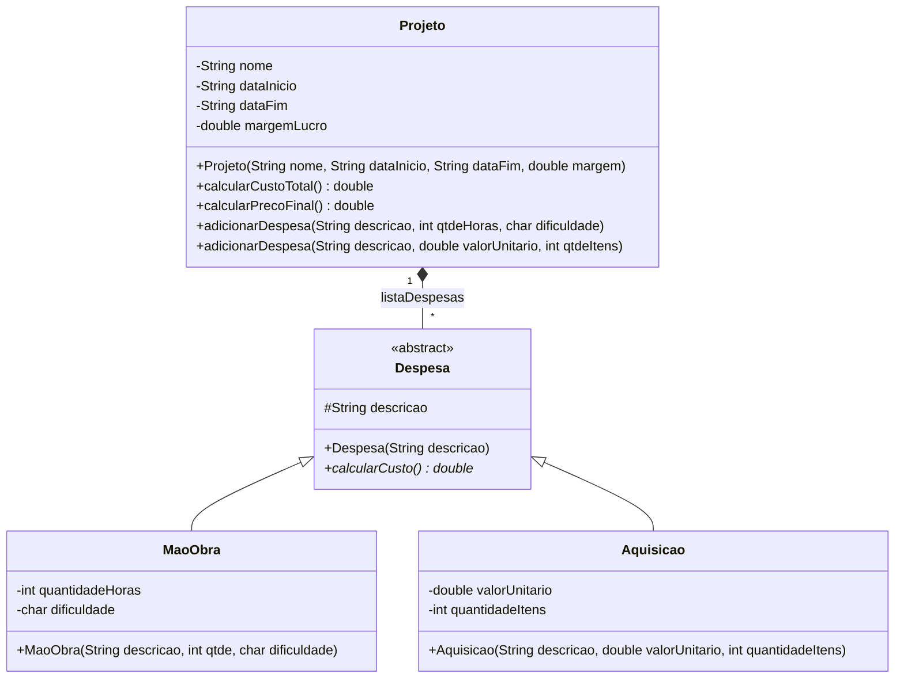

# SisCOAP — Sistema de Confecção de Orçamentos Aplicados a Projetos

Avaliação Prática M2 da disciplina de **Programação Orientada a Objetos**
(Ciência da Computação · UNIVALI · Escola Politécnica).

O SisCOAP ajuda prestadores de serviços a serem mais assertivos na formação de preço. A partir das despesas e da margem de lucro de um projeto, o sistema informa o **custo do projeto** e o **valor final a ser cobrado do cliente**.

## Funcionalidades

- Configuração do projeto: nome, data de início, data de término e percentual de lucro.
- Cadastro de quantas despesas o usuário quiser, de dois tipos:
  - **Aquisição de materiais:** descrição, valor unitário e quantidade de itens.
  - **Mão de obra:** descrição, dificuldade (`F`, `M` ou `D`) e horas de trabalho.
- Apresentação do custo total e do valor final ao cliente.

## Regras de negócio

| Item | Cálculo |
|------|---------|
| Despesa de aquisição | `valorUnitario × quantidadeItens` |
| Despesa de mão de obra | `quantidadeHoras × fatorDificuldade` |
| Fator de dificuldade | Fácil (`F`) = 10 · Médio (`M`) = 25 · Difícil (`D`) = 50 |
| Custo do projeto | `Σ despesas` |
| Valor final | `custo × (1 + margemLucro)` |

## Estrutura do projeto

```text
SisCOAP/
└── src/br/univali/siscoap/
    ├── cliente/
    │   └── Principal.java
    └── dominio/
        ├── Projeto.java
        ├── Despesa.java
        ├── Aquisicao.java
        └── MaoObra.java
```

- `cliente`: interface com o usuário (console).
- `dominio`: classes de negócio.

## Diagrama de classes (domínio)



- `Despesa` é abstrata e `calcularCusto()` é implementado por cada subclasse (polimorfismo).
- `Projeto` possui uma lista de despesas (composição).
- `adicionarDespesa` é **sobrecarregado**: uma versão para mão de obra e outra para aquisição.

## Como executar

Requisito: JDK 8 ou superior.

```bash
cd SisCOAP
javac -d out $(find src -name '*.java')
java -cp out br.univali.siscoap.apresentacao.Principal
```

No Windows (PowerShell), compile com:

```powershell
javac -d out (Get-ChildItem -Recurse src -Filter *.java).FullName
```

## Fluxo de uso

1. O sistema solicita os dados do projeto (o percentual de lucro é digitado em %, por exemplo `50`).
2. Solicita o tipo de despesa: `A` (aquisição) ou `M` (mão de obra).
3. Solicita os dados conforme o tipo escolhido.
4. Pergunta se deseja adicionar outra despesa (`S`/`N`); se sim, volta ao passo 2.
5. Apresenta o custo do projeto e o valor a ser cobrado do cliente.

## Plano de testes

### Cenário 1 — margem de lucro: 50%

- Mão de obra: 6 h fáceis, 2 h médias, 10 h difíceis → R$ 610,00
- Aquisição: 10 un. a R$ 15,00 e 2 un. a R$ 300,00 → R$ 750,00
- **Custo do projeto: R$ 1.360,00**
- **Valor final ao cliente: R$ 2.040,00**

### Cenário 2 — margem de lucro: 80%

- Mão de obra: 10 h fáceis, 10 h médias, 2 h difíceis → R$ 450,00
- Aquisição: 10 un. a R$ 1.500,00 → R$ 15.000,00
- **Custo do projeto: R$ 15.450,00**
- **Valor final ao cliente: R$ 27.810,00**

## Exemplo de execução

```text
=== SisCOAP - Orçamentos Aplicados a Projetos ===

Nome do projeto: Meu Projeto
Data de início: 01/01/2026
Data de término: 01/03/2026
Percentual de lucro (ex.: 50 para 50%): 50
Tipo de despesa ('A' aquisição, 'M' mão de obra): M
Descrição: Desenvolvimento
Dificuldade ('F' fácil, 'M' médio, 'D' difícil): F
Horas de trabalho: 6
Adicionar outra despesa? ('S' sim, 'N' não): N

Custo do projeto:    R$ 60,00
Valor final cliente: R$ 90,00
```

## Tecnologias

- Java
- Programação Orientada a Objetos: classes abstratas, herança, polimorfismo, sobrecarga e composição.
- Lógica de Programação
- Desenvolvimento de regras de negócio.

## Autor

Desenvolvido por **Irivam da Silva Junior** como atividade avaliativa da disciplina de POO — Prof. Carlos Henrique Bughi, MSc.
